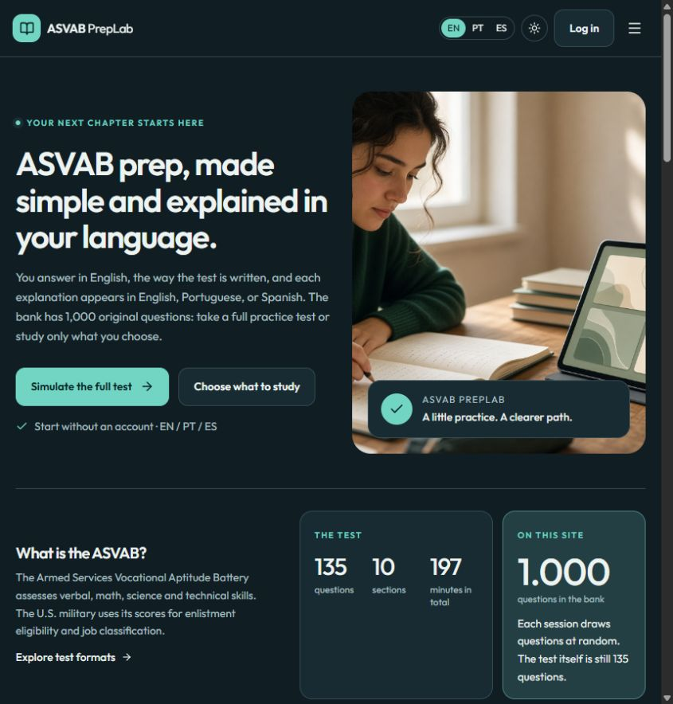
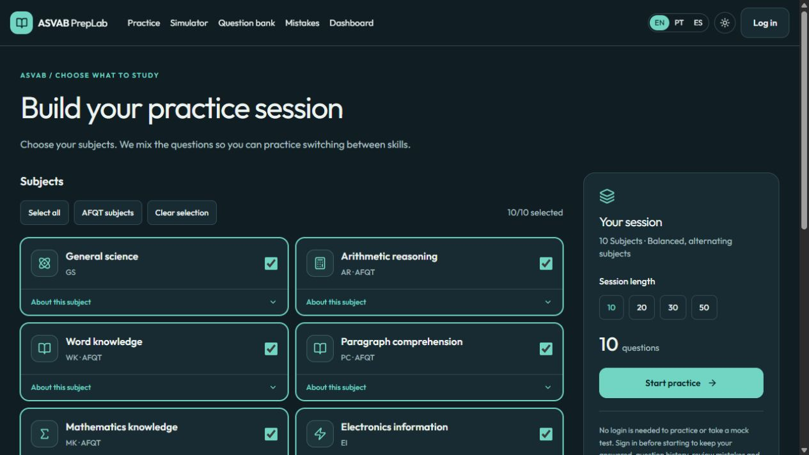
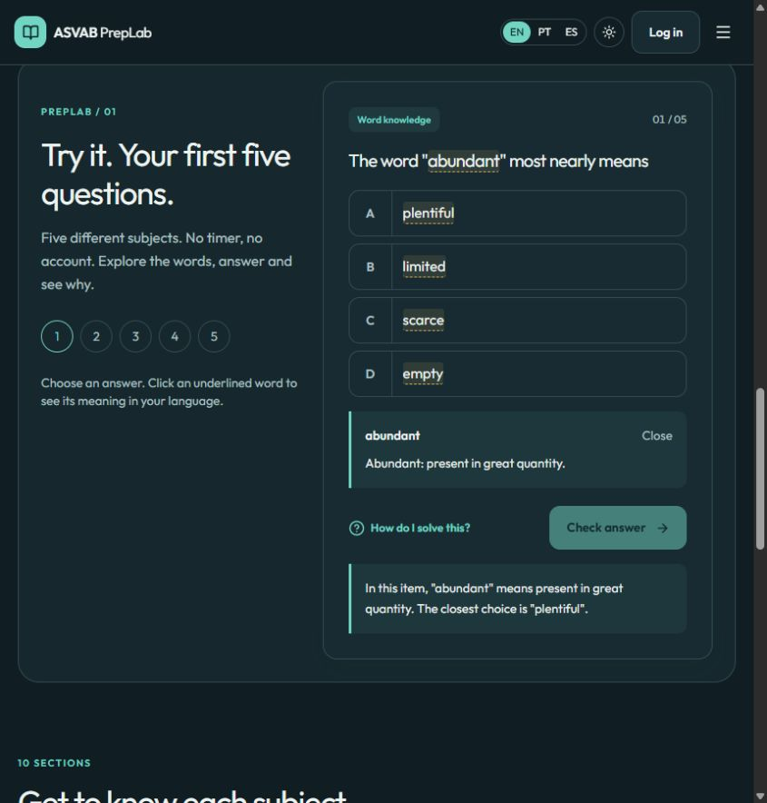

# ASVAB PrepLab

**Practice Smarter. Prepare with Confidence.**

A free, independent study app for the Armed Services Vocational Aptitude Battery (ASVAB). Practice the test's 10 subject areas, work through timed simulations, and review original questions with explanations in English, Portuguese, or Spanish. You can practice without an account; sign in to save your progress.

[Start locally](#getting-started) · [Compare the test formats](#official-test-formats)

> ASVAB PrepLab is an independent educational project. It is not affiliated with or endorsed by the U.S. Department of Defense or the official ASVAB testing program.

## The ASVAB and the AFQT

The ASVAB is an aptitude test used for military enlistment and career qualification. It has 10 subtests. The **AFQT is not a separate exam**: it is a percentile score calculated from Arithmetic Reasoning, Mathematics Knowledge, Word Knowledge, and Paragraph Comprehension. The other ASVAB subtests help determine military job qualifications.

| Subtest | Focus |
| --- | --- |
| General Science (GS) | Physical and biological sciences |
| Arithmetic Reasoning (AR) | Arithmetic word problems |
| Word Knowledge (WK) | Word meanings, context, and synonyms |
| Paragraph Comprehension (PC) | Information in written passages |
| Mathematics Knowledge (MK) | High-school mathematics |
| Electronics Information (EI) | Electricity and electronics |
| Auto Information (AI) | Automobile technology |
| Shop Information (SI) | Tools, shop terminology, and practices |
| Mechanical Comprehension (MC) | Mechanical and physical principles |
| Assembling Objects (AO) | How parts fit together to form an object |

## Official test formats

The official ASVAB is offered as a computer-adaptive test (CAT-ASVAB) and a paper-and-pencil test (P&P-ASVAB). The CAT adapts question difficulty to responses. The official fact sheet lists 135 scored questions and 197 minutes of section time limits for the CAT, and 225 questions and 149 minutes for P&P. Most examinees finish the CAT in about 1.5 hours; the P&P test takes about 3 hours.

| Format | Questions | Section time limits | Sections |
| --- | ---: | ---: | ---: |
| CAT-ASVAB | 135 scored | 197 min total | 10 |
| P&P-ASVAB | 225 | 149 min total | 9; AI and SI are combined as AS |

PrepLab's full timed practice follows the published question counts and section time limits. Its adaptive mode is a simplified practice approximation that adjusts among easy, medium, and hard items; it does not reproduce the official CAT's item-selection or scoring algorithms. Paper-format practice follows the published P&P counts and timing. PrepLab's AFQT indicator is based on practice accuracy in the four AFQT subjects. It does not predict or reproduce an official AFQT percentile or enlistment score.

## What PrepLab includes

- **1,000 original practice questions** across all 10 ASVAB subject areas. No official ASVAB questions are reproduced in the local question bank.
- Practice by subject, full timed and simplified adaptive simulations, and a paper-format simulation.
- Vocabulary help, hints, and step-by-step explanations in English, Portuguese, and Spanish.
- Optional accounts for saved history, missed-question review, favorites, and a progress dashboard.

These are study tools, not official test forms or score reports. The local adaptive practice is a difficulty-step approximation, and the AFQT indicator is a practice accuracy measure.

## Screenshots

Captured from the running app:



*The home page introduces the study options and includes a five-question sample.*



*Choose a subject or select several areas for focused practice.*



*A sample question with a clickable vocabulary definition and an optional solution hint.*

## Getting started

Requirements: **Node.js 20 or later**, Python 3, Docker, and Docker Compose. Python is used to generate the question bank during seeding. PyMuPDF is optional and is only needed for the PDF quarantine-import tool. PostgreSQL runs on port **5432**; Next.js runs at **http://localhost:3000**.

In PowerShell, from the repository directory:

```powershell
Copy-Item .env.example .env
npm install
npm run db:up
npm run db:deploy
npm run db:seed
npm run dev
```

Open [http://localhost:3000/en](http://localhost:3000/en). The interface is also available at `/br` and `/es`. Keep `.env` private and replace its placeholder `AUTH_SECRET` before deployment.

## Project layout and stack

- `src/app/` — localized pages and API routes; `src/components/` — study and exam interface.
- `src/lib/` — exam logic and shared utilities; `prisma/` — database schema and migrations.
- `content/` — question bank, sample questions, and vocabulary; `messages/` — translations; `scripts/` — bank generation and validation.

Built with Next.js 15, React 19, TypeScript 5, Prisma 6, and PostgreSQL 16.

## Official references

- [Official ASVAB — CAT-ASVAB format and timing](https://www.officialasvab.com/applicants/cat-asvab/)
- [Official ASVAB Fact Sheet — subtests, formats, lengths, and scores](https://www.officialasvab.com/wp-content/uploads/2025/04/ASVAB-Fact_Sheet.pdf)
- [Official ASVAB — sample questions](https://www.officialasvab.com/applicants/sample-questions/)
- [Official ASVAB — test-preparation disclaimer](https://www.officialasvab.com/applicants/asvab-test-preparation-disclaimer/)
